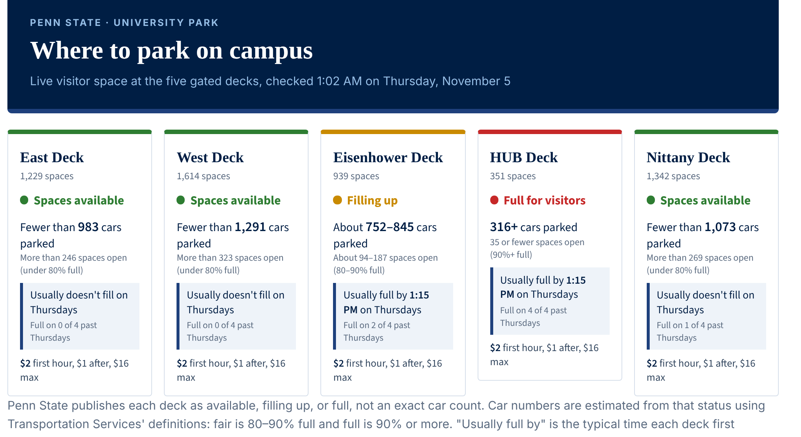
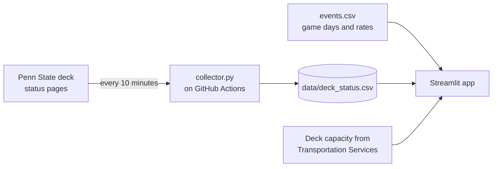

# Penn State Parking Deck Tracker

Live status, estimated cars parked, event pricing, and "usually full by" times for the five gated parking decks at Penn State University Park.

**Live app: [psu-deck-parking.streamlit.app](https://psu-deck-parking.streamlit.app/)**



*Example view. The live app shows the current status of each deck.*

## Why I built it

Penn State shows whether each deck has space right now, but not when it is likely to fill, and on football weekends the decks switch from hourly rates to flat event rates. Drivers have to guess. This project collects the public deck status around the clock and turns it into something you can plan with: how full each deck is, what it will cost today, and what time it usually fills.

## What the app shows

- **Live status** for East, West, Eisenhower, HUB, and Nittany decks
- **Estimated cars parked and spaces open**, using each deck's capacity and Transportation Services' status definitions (fair is 80 to 90% full, poor is 90% or more)
- **Usually full by**: the typical time each deck first showed as full on similar past days (same weekday, or past game days on a game day)
- **Today's price**: the normal hourly rate or the event rate, plus a cost calculator
- **History charts**: how full each deck has been over time and by hour of day
- **Spaces on each level** for every deck

## How it works



1. **Collect.** `collector.py` reads the public availability page for each deck and records good, fair, or poor with a timestamp. A GitHub Actions job runs it every 10 minutes and commits the readings to `data/deck_status.csv`.
2. **Add context.** `events.csv` lists home football games and their parking rates. Deck capacities per level come from Penn State Transportation Services.
3. **Show it.** `app.py` is a Streamlit app that combines live status, capacity, event pricing, and history.

## Early findings

From the first month of readings (October 2026), which were collected less often than the current 10-minute schedule, so these are rough:

- **HUB Deck** fills most often: it was marked full on 22 of 31 days, usually from late morning to early afternoon.
- **Eisenhower** filled on 11 days, **Nittany** on 7, **East** on 5, and **West**, the largest deck, on only 3.
- Midweek is busiest. On Wednesdays HUB was usually full by about 10:45 AM, and Eisenhower and Nittany by about 11:30 AM.

## Next steps

- Measure how accurate the "usually full by" times are against a simple baseline
- Compare the estimates with historical occupancy counts from Transportation Services
- Test whether rain and exam weeks make the decks fill earlier

## Run it yourself

```bash
pip install -r requirements.txt
python collector.py      # save one reading for each deck
streamlit run app.py     # open the app locally
```

## Data and thanks

Availability comes from Penn State Transportation Services' public deck pages. Thank you to Transportation Services for sharing deck capacities and the definitions behind the good, fair, and poor statuses.

This is an independent student project and is not affiliated with Penn State.

Built by Mohammed Alghamdi, Data Sciences, Penn State University.
